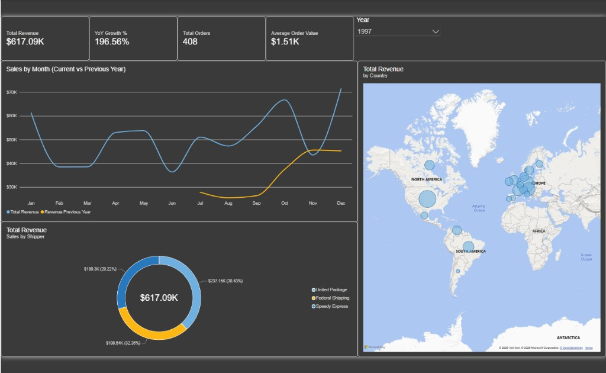
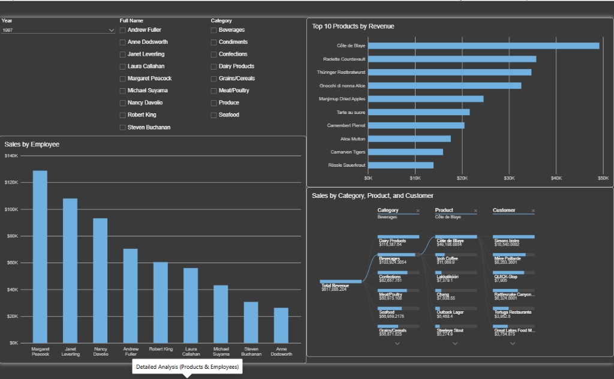
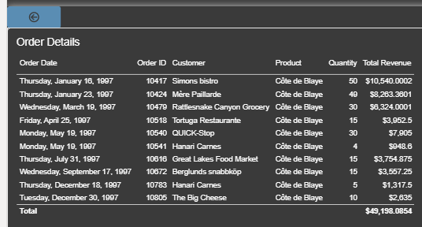
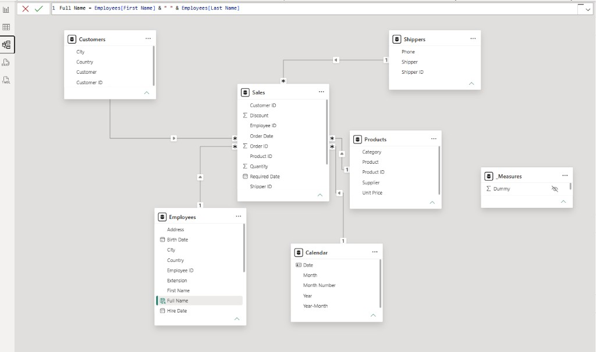

# Northwind Sales Dashboard

## SQL
Three views prepare the model before Power BI:

- `v_Product_Enriched` joins products, categories, and suppliers into one product dimension. Supplier company name is renamed to `supplier`.
- `v_Order_Sales` flattens orders and order_details into one fact row per order line. `total_line_amount` is `unit_price * quantity * (1 - discount)`.
- `v_Customer_Geo` keeps only customers who have at least one order, with city and country.

`employees` and `shippers` stay as separate dimension tables.

## Model
Star schema. `Sales` is the fact table. `Products`, `Customers`, `Employees`, `Shippers`, and `Calendar` filter it in a single direction. `Calendar` is a DAX date table marked as a date table and related to `Sales[Order Date]`. Measures live in `_Measures` and use `VAR`.

## Pages
- Executive Overview: revenue, YoY growth, orders, average order value, monthly trend versus the previous year, sales by country, and sales by shipper.
- Detailed Analysis: top 10 products, a breakdown from category to product to customer, sales by employee, and slicers for year, category, and employee.
- Drill-through: right-click a product to open its order lines (date, order, customer, product, quantity, amount).

## Screenshots

