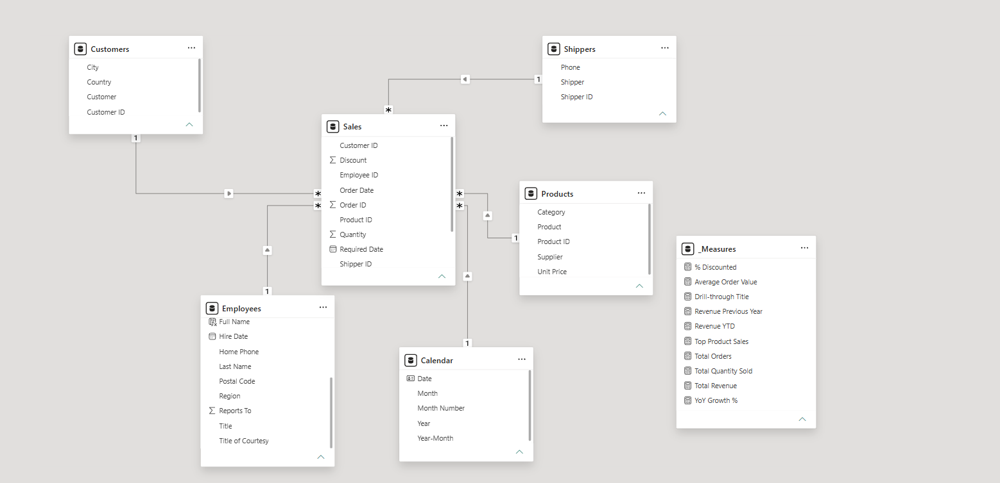
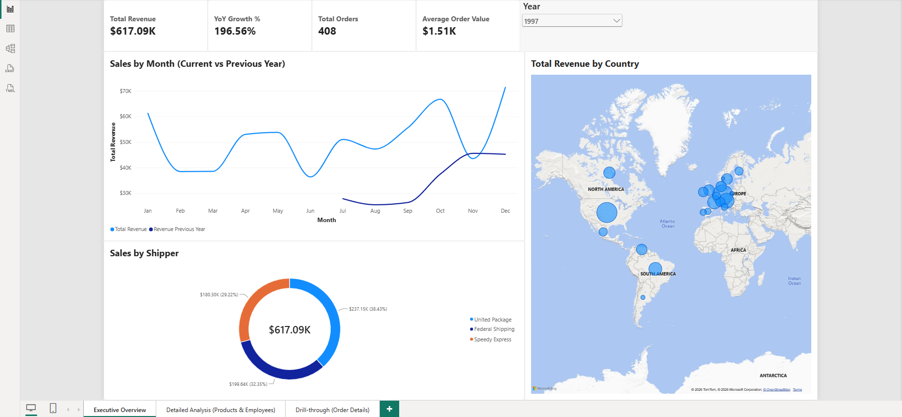
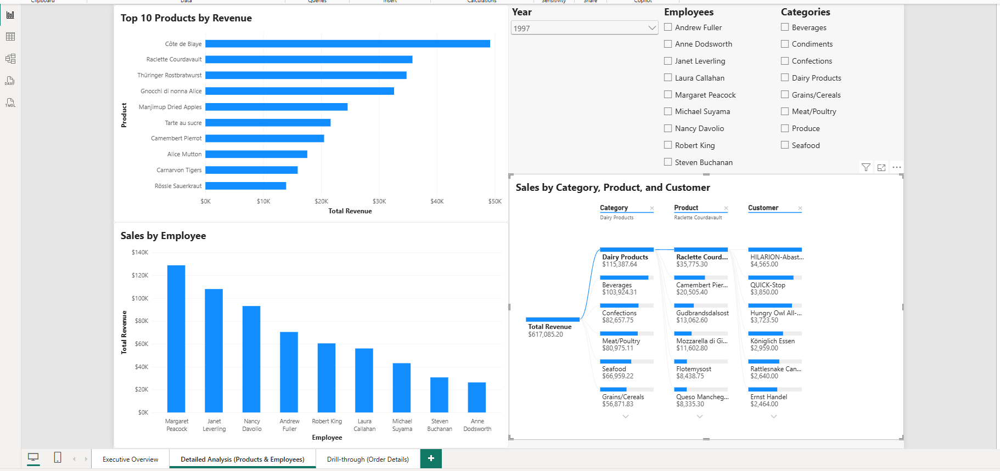
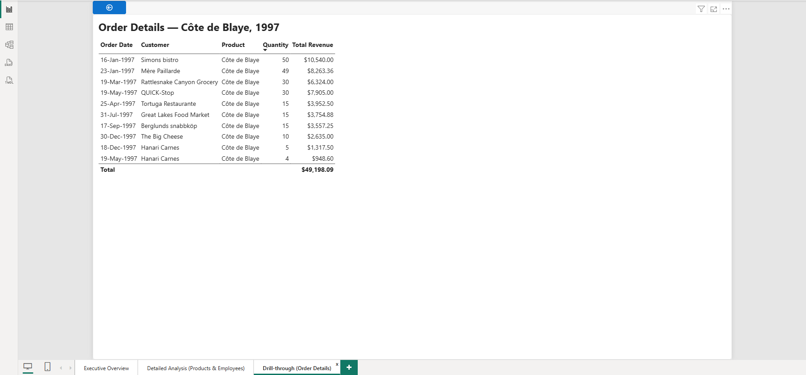

# Northwind Sales Analytics Dashboard

An end-to-end sales analysis project built with PostgreSQL, DBeaver, and Power BI Desktop. It prepares Northwind data in SQL, models it as a star schema, and presents revenue, product, employee, customer, and shipping insights in desktop and mobile layouts.

## Highlights

- PostgreSQL views perform the joins and calculate revenue before the data reaches Power BI.
- A single-direction star schema connects Products, Customers, Employees, Shippers, and Calendar to Sales.
- DAX measures cover revenue, orders, quantity, AOV, YTD, previous-year revenue, YoY growth, discounted revenue share, and top-product sales.
- Three report pages provide an executive overview, detailed analysis, and product drill-through.
- Light, color-conscious styling, explicit axis titles, and optimized mobile layouts improve accessibility.

## SQL preparation

[`northwind_views.sql`](northwind_views.sql) creates three views:

- `v_Product_Enriched` combines products, categories, and suppliers into the product dimension.
- `v_Order_Sales` combines orders and order details at order-line grain and calculates `total_line_amount` as `unit_price * quantity * (1 - discount)`.
- `v_Customer_Geo` keeps active customers and their locations for geographic analysis.

Power Query imports those views together with `employees` and `shippers`, selects the required columns, assigns the correct data types, and gives technical fields report-friendly names.

## Data model

`Sales` is the fact table. `Products`, `Customers`, `Employees`, `Shippers`, and the DAX `Calendar` table filter it through single-direction many-to-one relationships. The model uses Order Date as its active calendar relationship and does not require bidirectional filtering.

## Report pages

### Executive Overview

Four KPI cards summarize Total Revenue, YoY Growth %, Total Orders, and Average Order Value. The page also compares monthly revenue with the previous year and shows revenue by customer country and shipper.

### Detailed Analysis

This page contains the top 10 products by revenue, sales by employee, and a decomposition tree from Category to Product to Customer. Year, employee, and category slicers provide context for every visual.

### Drill-through

Right-clicking a product on the Top 10 chart opens its order details while preserving the selected year. A dynamic title identifies the product and year, and the table shows Order Date, Customer, Product, Quantity, and Total Revenue.

## Notes

- The unusually high 1997 YoY result is expected: Northwind contains only a partial prior year beginning in July 1996.
- Supplier is retained as an attribute of Products; the required page specification does not prescribe a separate supplier visual.
- Mobile layouts reuse the same visuals and measures while adapting slicers, labels, charts, and the drill-through table to a phone canvas.

For the full technical rationale, see [`Documentation.md`](Documentation.md). The Power BI report is available as [`Northwind_Sales_Dashboard.pbix`](Northwind_Sales_Dashboard.pbix).
